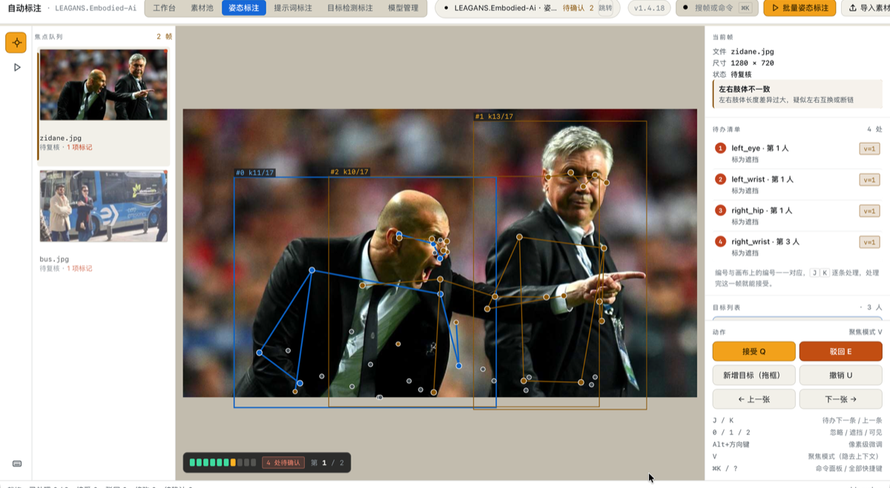
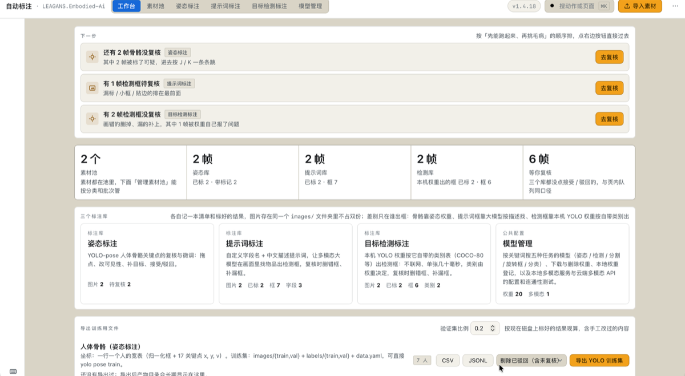
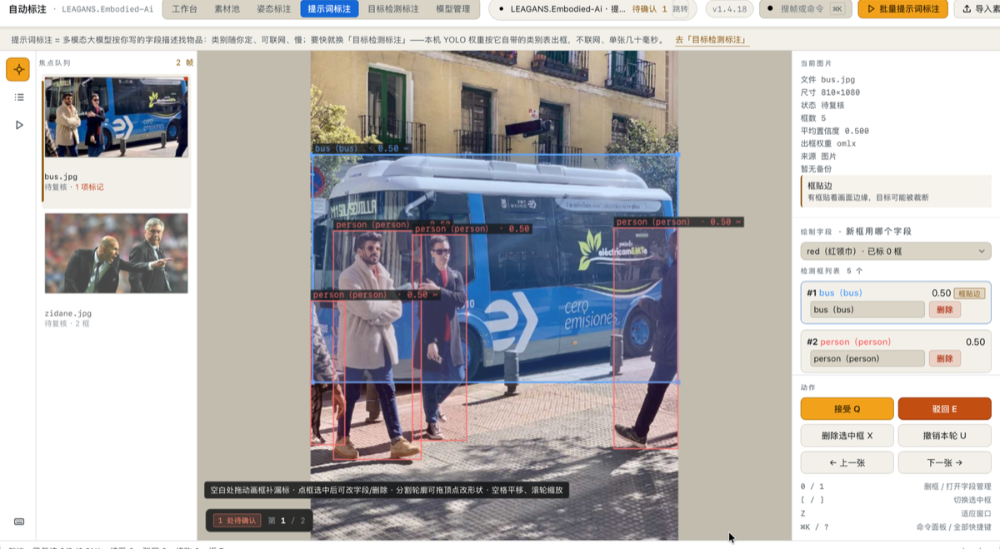
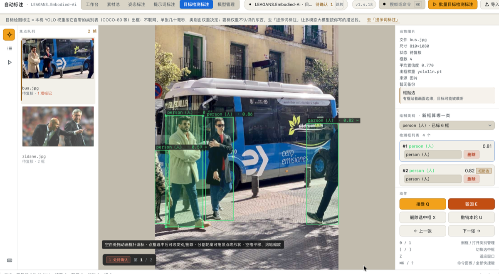
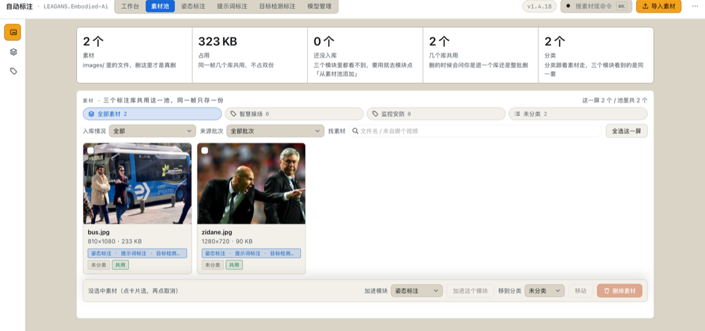
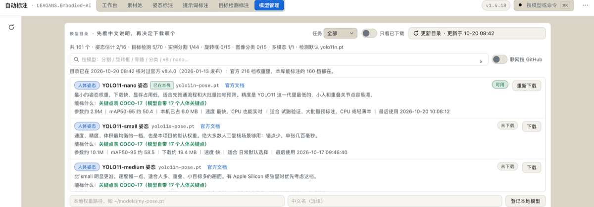
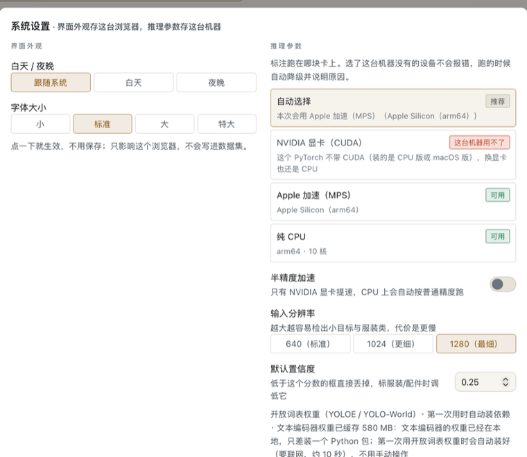

# 自动标注系统（人体骨骼 · 提示词 · 目标检测 / 分割）

[](LICENSE)
[](#环境)
[](#环境)
[](#和别的标注工具比)

**本地离线的半自动标注工具**：用 YOLO-pose 批量生成**人体骨骼关键点**，用一句中文描述（多模态大模型）或本机 YOLO 权重生成**目标检测框**，人工只在浏览器里改模型错的那几个点，直接导出 `yolo pose train` / `yolo detect train` 能吃的数据集。

**开发者 [windinchen](https://github.com/windinchen)** · 源码与发布 <https://github.com/windinchen/autolabel> · 版本号看 `autolabel version`（界面顶栏右侧常驻显示）

> 用 YOLO-pose 批量生成人体骨骼关键点标签，人工只在浏览器里改模型错的那几个点。
> 另有两条独立的检测框链路：**提示词标注**（一句中文描述，让多模态大模型逐张图找物品）与**目标检测标注**（本机 YOLO 权重按它自带的类别表出框）。

给一堆图片（或一段视频），用现成的姿态模型批量生成人体骨骼关键点标签，人工只需在浏览器里**修正少数可疑帧**，最后导出两样东西：可直接 `yolo pose train` 的数据集，以及带像素/归一化坐标的 CSV / JSONL 文件。

设计目标不是"全自动"，而是把人工工作量从"逐张从零画 17 个点"降到"只改模型错的那几个点"。

第二条链路是**提示词标注**：用一句中文描述（"桌上或手里拿着的塑料水瓶，含纸杯、保温杯"）让多模态大模型逐张图找物品，产出检测框，复核时删掉标错的、补上没找到的，导出 `yolo detect train` 数据集。详见 `demo_docs/09-提示词标注.md`。

第三条链路是**目标检测标注**：本机的 YOLO 检测 / 分割 / 旋转框权重按**它自带的类别表**（COCO-80 等）出框，不联网、单张几十毫秒，适合常见物品与大批量预标注；先选权重、再勾权重认识的类别，剩下的交给机器。用**开放词表权重**（`yolov8x-world.pt`、`yoloe-26x-seg.pt`）时这一条反过来——类别不用权重自带，你填英文词就行（只能英文，中文会零检出）。写的词到底认不认识，用**试词**当场问：类别管理里的「先试词」或 `detect --probe "t-shirt,shirt"`，拿一张图跑一次**只读**推理，一个词一行回你最高分和下一步该改什么（换权重 / 降阈值 / 换图），不改任何数据。分割权重落的轮廓还能在画布上**拖点**改形状。详见 `demo_docs/11-目标检测.md`。

**检测框两条链路怎么选**（界面上每个页面都常驻这句话，因为两页长得太像）：权重认识的东西用「目标检测标注」（快、不联网、类别由权重定），权重不认识的东西用「提示词标注」（灵活、可联网、类别随你写）。

三条链路是**三个独立的标注库**（`--lib pose|objects|detect`）：各自一套索引、批次表、标签目录、原件与撤销快照，删图/复核/撤销互不影响。素材单独一层——**素材归池，标注归库**：`images/` 里的文件、素材分类和导入来处归素材池（账本 `.autolabel/pool.json`），三个库只存「我引用了这张」和标注结果；同一帧只落盘一次，素材要等所有引用方都不要了才真删。界面对应 `/pool` 那一页：上传可以只进池不入库，各模块要标什么就从池里挑（`从素材池添加`），分类跟着素材走、三个模块看到的永远一致；导入那一刻就在素材身上盖**来处章**（认第一次，不被后面那次改挂），`B` 切到批次记录能一次看到导入的和各模块标注过的每一批，删错了「捞回上次删除」把标签原文、索引条目、批次记录一起装回来。老数据集用 `autolabel migrate <数据集>` 一键拆分（幂等）。

完整文档见 `demo_docs/`（文档索引：`demo_docs/README.md`），改代码请同步更新那边。

<p align="center">
  
</p>

<p align="center">
  <sub>姿态标注页 —— 左边焦点队列、中间骨骼、右边「待办清单」按「先修错的、再看可疑的」排好，逐条 <code>J</code> / <code>K</code> 跳过去改</sub>
</p>

## 工作流程

```
图片 / 视频
   │  import（规范化 RGB、展开 EXIF 旋转、限最长边、去重）
   ▼
datasets/<名称>/images
   │  label（YOLO-pose 推理 + 翻转融合 + 可见性判定 + QC 打标）
   ▼
labels/*.txt（YOLO pose 格式）+ .autolabel/index.json
   │  qc（报告 + 复核优先级清单 + 骨架叠加图）
   ▼
review（浏览器拖拽修正，接受/驳回，自动落盘、可撤销）
   │  export（train/val 划分 + data.yaml + 可选 COCO JSON）
   │  coords（CSV / 长表 CSV / JSONL 坐标文件，含像素与归一化两套坐标）
   ▼
yolo pose train

（并行链路 A）同一批 images
   │  fields（定义要标什么物品 + 描述提示词）
   │  prompt（多模态大模型逐张找目标 → prompt_labels/*.txt，5 列 detection）
   ▼
提示词标注页删错框 / 补画漏框 → prompt --export
   ▼
yolo detect train

（并行链路 B）同一批 images
   │  detect（本机 YOLO 权重按自带类别出框 → detect_labels/*.txt，5 列 detection）
   │  类别号由本库登记表决定，同名类别永不换号；分割权重还会把轮廓一起落盘
   ▼
目标检测标注页删错框 / 补画漏框 → detect --export
   ▼
yolo detect / segment train
```

## 和别的标注工具比

如果你在搜「labelImg 有没有自动标注」「CVAT 能不能先跑模型再改」，这一节就是答案。

| | 这个项目 | labelImg / LabelMe | CVAT | Label Studio |
| --- | --- | --- | --- | --- |
| 先出结果、人只改错 | ✅ 模型先标，人工只动可疑帧 | ❌ 从零手画 | ⚠️ 要自己搭模型 + 服务 | ⚠️ 要自己接 ML backend |
| 人体骨骼关键点 | ✅ 17 点，可见性三态，逐点拖 | ⚠️ LabelMe 能画点，无模型 | ✅ 有骨架模板，无自动 | ⚠️ 需自建 |
| 目标检测标注 | ✅ 本机权重 / 一句中文描述 | ❌ 手画 | ✅ | ✅ |
| 部署 | ✅ 一条命令起本地服务，无数据库、无 Docker | ✅ 单机 | ❌ Docker + 后端 + 数据库 | ❌ Docker + 后端 |
| 数据出不出本机 | ✅ 默认全离线；联网只在你勾选时用于搜权重 | ✅ | ⚠️ 看部署 | ⚠️ 看部署 |
| 直接产出 YOLO 训练集 | ✅ `images/labels + data.yaml`，含切分与去重 | ❌ 要自己转 | ⚠️ 导出格式要转换 | ⚠️ 要自己转 |
| 适合的规模 | 几百到几万张、单人 / 小团队 | 几十张 | 团队标注流水线 | 通用标注平台 |

一句话取舍：**你要的是「模型先干 90%，我改剩下 10%」，并且不想为标注这件事再维护一套 Docker 服务**，那就用这个。

## 环境

**macOS 和 Windows 用的是同一套代码，双击就能起**：macOS 双击 `运行工作台.command`，Windows 双击 `运行工作台.bat`。环境自检、签本地证书、起服务、等端口真监听了再开浏览器——这一整套判断都在 `autolabel/launch.py` 里，两条启动链路共用同一份，不存在「mac 修好了 Windows 忘了」那种事（以前启动逻辑写在 zsh 里，Windows 连门都进不去）。

已在本机验证：macOS（Apple M3 Ultra）+ Python 3.9.6 + `torch 2.8.0` + `ultralytics 8.4.24`，推理默认走 Apple Silicon 的 MPS，这台机器上不依赖 CUDA。

装了 NVIDIA 显卡的机器（Linux / Windows + CUDA 版 PyTorch）不用改代码：界面 `⌥S` **系统设置** 或 `autolabel settings --device cuda` 切成 CUDA，界面会先探测这台机器到底有哪几张卡、说清型号；所选设备当场用不了也不报错，跑的时候自动降级并说明原因。常驻服务里也能按实例固定算力（`configs/后台实例.conf` 一行一个实例，第四列写 `cuda`），不用每次开界面再点一遍。

**Windows 上要提前准备的只有两样**：

1. **Python 环境**：装一次 `uv`（`winget install astral-sh.uv`）以后就不用管了——脚本会自己在 `%USERPROFILE%\.local\bin`、`%LOCALAPPDATA%\Programs\uv`、`%USERPROFILE%\.cargo\bin` 和 `PATH` 里找它，找到就顺手把 Python 3.11 和依赖备齐。没装也能跑：脚本会退回系统 Python 并提示你自己 `python -m pip install -r requirements.txt`。
2. **摄像头要的 HTTPS**：第一次启动自动签一张本地证书，并用 `certutil -addstore -user Root` 把根证书加进**当前用户**的受信任根证书——不要管理员权限、不动系统级证书列表（对应 macOS 的 `security add-trusted-cert`）。装不上不拦路：服务照样起，只是退回 HTTP，看图改标签全正常，只有摄像头录不了像。

另外三件 Windows 特有的事，代码里都已经兜住了，写在这儿免得被当成 bug：常驻服务用**任务计划程序**（登录触发 + 失败自动重启，语义对齐 launchd 的 `KeepAlive`），任务名 `AutoLabel-<实例名>`；日志在 `%USERPROFILE%\.autolabel\logs\autolabel-<端口>.log`，不放 `%TEMP%`——存储感知会清临时目录，崩溃现场跟着一起没；导出训练集默认想省空间用软链，但 Windows 建软链要开发者模式或管理员权限，所以会自动退到硬链接、再退到复制，导出结果里如实写明这次用的是哪一种。

```bash
python3 -m pip install -r requirements.txt   # 已有 torch/ultralytics 可跳过
python3 -m pytest tests -q                    # 1267 项测试，约 2 分钟
# 其中 5 项端到端用例需要 models/yolo11n-pose.pt 与 models/bus.jpg，缺权重时会自动跳过（`-rs` 可看到原因）
```

## 5 分钟上手

### 一条命令跑完

```bash
# 视频 + 批量图片混合提交：入库 → 自动标注 → QC 报告 → 坐标文件
python3 -m autolabel auto datasets/myset 录像.mp4 ~/Pictures/人像 --fps 0.5
# 坐标产物：datasets/myset/coords/<时间戳>/coords.csv、coords.jsonl 等
python3 -m autolabel review datasets/myset      # 需要人工修正时再打开
```

`auto` 按扩展名自动分流：`.mp4/.mov/.mkv/...` 走抽帧，其余按图片目录导入；标注、去重、断点续跑参数与分步命令一致。

### 分步执行

```bash
D=datasets/demo
python3 -m autolabel init    $D --name LEAGANS.Embodied-Ai
python3 -m autolabel import  $D models/bus.jpg models/zidane.jpg
python3 -m autolabel label   $D --model yolo11n-pose.pt --render-qc 4
python3 -m autolabel qc      $D --render 10
python3 -m autolabel ca                    # 只做一次：签本地 HTTPS 证书（摄像头需要）
python3 -m autolabel review  $D          # 自动打开 https://localhost:8765
python3 -m autolabel export  $D --val-ratio 0.2 --coco
```

训练：

```bash
yolo pose train data=$D/exports/<时间戳>/data.yaml model=yolo11s-pose.pt epochs=100 imgsz=640
```

实测吞吐（M3 Ultra / MPS / 1920x1280 输入，含解码与预处理）：

| 配置 | 速度 |
| --- | --- |
| `yolo11n-pose` imgsz=640 | 17 ms/张（约 60 张/秒） |
| `yolo11n-pose` imgsz=960 | 17 ms/张（约 58 张/秒） |
| 开启 `--flip`（默认开） | 34 ms/张（约 30 张/秒，约 10 万张/小时） |

## 标签格式与可见性语义

`labels/<图片名>.txt`，每行一个人，全部数值按图片宽高归一化：

```
class_id cx cy w h  x1 y1 v1  x2 y2 v2 ... x17 y17 v17
```

关键点顺序为 COCO-17：`nose, left_eye, right_eye, left_ear, right_ear, left_shoulder, right_shoulder, left_elbow, right_elbow, left_wrist, right_wrist, left_hip, right_hip, left_knee, right_knee, left_ankle, right_ankle`。

`v` 的取值是本系统最容易踩坑的地方：

| v | 含义 | ultralytics 训练行为 |
| --- | --- | --- |
| 0 | 未标注 / 忽略 | **不参与**监督（`kpt_mask = v != 0`） |
| 1 | 遮挡但位置可推断 | **参与**监督，权重与 v=2 相同 |
| 2 | 清晰可见 | 参与监督 |

所以"想让某个点不产生监督"必须写 `v=0`，写 `v=1` 等于照样教模型。默认策略 `threshold` 下：关键点置信度 ≥ `--visible-conf` 记 2，≥ `--occluded-conf` 记 1，其余记 0。想要"只训高置信点"，把两个阈值设成一样即可退化为二值。

无人图会写出**空标签文件**，这是 YOLO 的背景图约定，能当负样本压误检；导出时由 `--max-empty-ratio` 控制比例，默认上限 15%。被比例挡掉的帧不会悄悄消失：命令行多打一行「剔除明细」，`manifest.json` 的 `skipped` 逐张写明原因。

## 界面（一套壳 · 六个页面）

`review` 启动的是纯标准库 HTTP 服务 + 原生 Canvas 前端，无构建步骤、不联网。一个服务六个页面（工作台 / **素材池** / 姿态标注 / 提示词标注 / 目标检测标注 / 模型管理），共用同一个数据集目录；老数据集不用先手动迁移也能直接打开（启动时自动补齐缺失的库索引）。六个页面共用**同一套壳**：顶栏（品牌 · 模块切换 · `⌘K` 搜索 · 一个主按钮 · `⋯` 溢出菜单）+ 左侧 52px 竖条。**分工写死**：模块跳转只在顶栏中文标签与 `⋯` 菜单「去别的模块」两处（同一张模块表渲染，当前模块用天蓝描边标出）；竖条只放本页自己的面板开关（焦点队列 / 批量标注 / 字段·类别管理 / 素材视图切换 / 分类管理），**导入素材不在竖条上**——它六页统一在右上角那一颗，以前竖条还挂过第二颗一模一样的；帮助按钮常驻底部，六页同一个 id、同一处接线。`⌘K` 命令面板与 `?` 速查表在六页都能开，**系统设置**（外观 + 推理算力）六页同一个入口；顶栏右侧常驻**版本徽标**（点开直接进 GitHub 仓库，有新版本时变琥珀色并带一个圆点），`⋯` 菜单底部的**关于**写着开发者、当前版本与 GitHub 上的最新版，就地能「检查更新」。

| 地址 | 模块 | 内容 |
| --- | --- | --- |
| `/` | 工作台 | **“下一步”行动流**（按「先能跑起来、再挑毛病」排序，最多三条，每条带直达按钮：先去复核 / 先去标注 / 去下载权重 / 去导出）、概览数字（素材池 / 姿态库 / 提示词库 / 目标检测库 / 等你复核 / 导入批次）、三个标注库入口（各带「导入图片 / 视频」）、三套坐标下载 + 三个库各自的 YOLO 训练集导出（各带「上次导出」路径与复制按钮）、三库批次统一管理与逐张删除、启动对账提示条。「重新读取磁盘」在 `⋯` 菜单里，快捷键 `R` |
| `/pool` | 素材池 | **素材归池、标注归库**：上传可以只进池不入库，分类跟着素材走、三个模块看到的永远一致；导入那一刻盖**来处章**，`B` 切到批次记录能看到导入的和各模块标注过的每一批，删错了「捞回上次删除」把标签原文、索引条目、批次记录一起装回来 |
| `/pose` | 姿态标注 | 人体骨骼的自动标注与人工复核（`/review` 为改名前的老地址）；库里已有的图按 `G` 直接**批量姿态标注**，不必重传素材，CSV / JSONL / YOLO 训练集三个导出在顶栏 `⋯` 菜单里，也能按 `⌘K` 搜「导出」 |
| `/objects` | 提示词标注 | 字段管理、批量提示词标注、删错框与补画漏框、检测框坐标与训练集导出 |
| `/detect` | 目标检测标注 | 选本机 YOLO 权重 → 勾它自带的类别（开放词表权重改成填英文词，旁边有**先试词**问清认不认）→ 批量出框 → 删错框补漏框、**拖轮廓点改形状** → 坐标与训练集导出。本库独立上传口，姿态权重会被挡在下拉框外并说明原因（快捷键 `O` 与提示词标注互跳） |
| `/models` | 模型管理 | **模型搜索**（本机目录 + 可选联网搜 GitHub，带中文介绍 / 体积 / 参数量 / 能标哪些类别 / 下载）、**更新目录**（联网核对官方最新档位）、**模型列表**（本机已下载 + 每个标注模块的默认模型只在这一个地方设）、多模态大模型配置（快捷键 `M` 直达） |

骨骼写姿态库（`labels/` + `.autolabel/index.json`），提示词出的框写提示词库（`prompt_labels/` + `.autolabel/objects/index.json`），本机权重出的框写目标检测库（`detect_labels/` + `.autolabel/detect/index.json`），三套标签、三套批次、三套导出互不覆盖，素材池 `images/` 共用。「提示词标注」与「目标检测标注」共用同一份前端脚本（`objects.js`），靠页面里的 `data-lib` 选配置行，接口靠 `lib` 参数分流——同一件事只有一个入口。

<p align="center">
  
</p>

<p align="center">
  <sub>工作台（<code>/</code>）—— 顶部「下一步」按「先能跑起来、再挑毛病」排序，中间六格概览（素材池 / 三个标注库 / 等你复核）与三个标注库入口，底部三套训练集与坐标导出</sub>
</p>

<p align="center">
  
  
</p>

<p align="center">
  <sub>左：提示词标注（<code>/objects</code>）—— 多模态大模型按你写的字段找东西，框上带真实置信度<br>右：目标检测标注（<code>/detect</code>）—— 本机权重按自带类别表出框，不联网、单张几十毫秒</sub>
</p>

<p align="center">
  
  
</p>

<p align="center">
  <sub>左：素材池（<code>/pool</code>）—— 三个库共用的素材只落盘一份，分类与来处章跟着素材走<br>右：模型管理（<code>/models</code>）—— 中文说明、体积、参数量、自带类别表，下载与默认模型都在这一处</sub>
</p>

<p align="center">
  
</p>

<p align="center">
  <sub><code>⌥S</code> 系统设置 —— 外观存这台浏览器，推理参数存这台机器；不可用的设备会写明原因并当场降级</sub>
</p>

### 姿态标注页


- 拖动关键点、`Alt+方向键` 像素级微调、`0/1/2` 切换可见性、`X` 删除误检、拖框新增目标
- **待办清单**是复核主线：把这一帧真正值得动手的关键点（贴边、被标遮挡、置信度 <0.4）按「先修错的、再看可疑的」排好，编号 1…9 同时画在画布上，`J` / `K` 逐条跳，清单清空就能 `Q` 接受；`V` 聚焦模式把非选中目标淡去
- `Q` 接受 / `E` 驳回并自动翻页，画布下方弹 **5 秒撤销条**（点撤销、按 `U` 反悔，撤销的是**刚定论的那一帧**：状态退回原样并跳回去；撤销条收起来之后 `U` 才是「撤销当前帧的一次坐标修改」）；`F` 跳到下一张待确认（带 QC 标记**或**整体置信度偏低，正向标记不算）
- 左侧**竖排焦点队列**一帧一行（缩略图 + 文件名 + `待复核 · 3 项标记`，带标记的有红点），`↑` `↓` 在队列内移动；顶栏胶囊显示 `待确认 N` 并给 `跳转`
- 画布左下角 HUD：关键点可见性色块 + `N 处待确认` / `无需修改` + `第 N / M`；右侧面板上半可滚（帧信息 → 待办清单 → 目标列表，**目标列表只展开当前选中那个**），下半固定放动作按钮
- `⌘K` 命令面板（六页通用：动作、筛选、按文件名搜帧、模块跳转）、`?` 打开本页快捷键速查
- **外观**：白天 / 夜晚两套主题 + 四档字号（小 / 标准 / 大 / 特大），六个页面通用，选择记在本机浏览器（`autolabel.appearance`），刷新与重启都保持；默认「跟随系统」跟 macOS 浅深色自动走。白天是单独调过的一整套色值（暖纸白底 + 压深的强调色），不是把背景涂白；画布上的框、骨骼、标签底色也一起换主题，压在照片上的深色 HUD 两种主题都保持深。入口统一在 `⌥S` **系统设置**（`⋯` 菜单、`⌘K` 搜「系统设置」也到同一处），`⌥T` 切昼夜 / `⌥=` / `⌥-` 调字号照常可用
- **推理算力**：同一个面板里选标注跑在哪块卡上——自动选择 / NVIDIA 显卡（CUDA）/ Apple 加速（MPS）/ 纯 CPU，外加半精度开关。面板打开时才探测显卡（`import torch` 不该拖慢每次切页），列出识别到的型号；这台机器用不了的那档写明原因但照样能选（换台机器接着用）。存 `~/.autolabel/settings.json`，跟机器不跟数据集，命令行与界面读同一份
- 改动防抖 600ms 自动写回标签；首次修改前把自动标注原件备份到 `.autolabel/originals/`，保留最近 10 个历史快照，`U` 可逐级撤销
- 关键点被拖出框外时 bbox 会自动撑开（`heal_bbox`），避免"点在线段外、框却没包住"的训练噪声
- 右上角 **导入素材**：拖拽或选择视频、图片、整个图片目录，后台自动抽帧 + 标注 + QC + 生成坐标文件，进度实时显示；导出三件套（**坐标 CSV / 坐标 JSONL / YOLO 训练集**）在顶栏 `⋯` 菜单，导出过一次后顶栏下方常驻「上次导出」路径，带 **在访达中显示 / 复制路径 / 复制训练命令**
- **清除任务**：上传弹层与任务进度条上各一个按钮，确认后可删掉排队中的任务（连带清理上传临时文件）、取消正在标注的任务（标完当前图即停，已标好的保留并刷新坐标文件）
- **批次管理**（主页底部）：每次导入/上传自动记为一个批次并写进所属库的批次表，主页把**三个库的批次放在一起管**——按模块筛选与汇总，每行同时显示骨骼进度与检测框进度（走跨库视图，与展开的逐张清单一致），`看文件` 展开到逐张图片并**单张删除**（勾选可批量删），整批删除一并在行首勾选完成。删除分两种力度：默认**从本库移除**（素材与另外两个库的标注都不动），勾「连图片文件一起删」才三个库一起摘并删 `images/` 里的素材；删除前自动快照到 `.autolabel/deleted/`（只保留最近 200 份，逐张删两万张不会攒出两万个文件），坐标与 QC 随之重算，被删空的批次记录自动移除。姿态页仍保留老弹层（快捷键 `B`，只列姿态库批次），含「只看这批」
- **提示词标注页**（`/objects`，快捷键 `O` 直达，详见 `demo_docs/09-提示词标注.md`）：右上角 **导入素材**（快捷键 `W`）是本库独立上传口，入库后直接出检测框、不跑 YOLO-pose；弹层里的 **从素材池添加** 直接领用姿态库已传过的同一份素材（不重传、不复制文件）；画布上空白处拖动**补画**模型漏掉的目标（字段取「绘制字段」下拉框）、框内拖动移动、拖角点改大小、`X` 删标错的框、框列表里直接**改字段**（画错类不用重画）、`U` 撤销（第一次画完也能撤销回空白，`Z` 是适应窗口）。壳层与姿态标注页同一套：竖排焦点队列、画布 HUD 与 5 秒撤销条、`⋯` 菜单里的筛选与三个导出、`⌘K` 命令面板与 `?` 速查表；数字键在两页含义不同（这页 `0` 删框、`1` 字段管理）。「字段管理」新建字段（英文名 + 中文显示名 + 描述提示词），「批量提示词标注」选字段与多模态配置后走任务队列，可与姿态任务一样「清除任务」。
- **分割轮廓能手工拖点**（目标检测库）：选中带轮廓的框后，轮廓上的**实心点是顶点**（拖动改形状）、**空心点是边中点**（拖它在那条边上加一个点），`Alt + 点` 删点（最少留 3 个）；松手后方框自动收成轮廓的新外接框，不会出现「框是框、形状是形状」对不上。拖框 / 缩放时轮廓整条仿射跟随；人工新画的方框仍然不带轮廓——硬套一个形状是编数据。
- **启动对账**：启动时先按库自动 `migrate`（老布局升级；纯姿态数据集这种「没有提示词条目可搬」的老目录也会顺手补一本空的 `.autolabel/objects/index.json`，否则复核服务会因缺索引起不来），再逐库对账——导入/标注中途被打断时（重启服务、Ctrl+C、断电），已落盘但没进索引的图片会补回它自己库的索引并挂到那个批次上，无人认领的"标注中"批次判定为**已中断**，工作台顶部写清补回多少张；某库还在标注时另一个库不会抢走它的孤儿素材，`--keep-files` 保留的文件不会被误当成孤儿。对账时**每个库只解析一次对面库的索引**（不是每扫到一张图就重读一遍），1500 张的数据集启动对账从约 1 秒降到 0.04 秒。
- **模型管理**（独立页 `/models`，快捷键 `M`，详见 `demo_docs/08-模型管理.md`）：**模型目录**按 `ultralytics/assets` 每个 release 的实际文件列出 160 档（五种任务，中文说明、参数规模、mAP、预计体积、关键点集或自带类别表、适合场景），默认「只看已下载」、按任务贴类别徽标，行内直接下载并留完整下载记录（URL、镜像、SHA256 是否一致、字节数、耗时），右上**更新目录**联网核对官方最新发布——新档位连中文介绍一起补进来、体积改正，缓存进 `configs/models.json` 的 `hub_catalog`，断网只说一句原因目录不动；**模型列表**区块只管 `models/` 里真有的文件：就绪状态、实际占用大小、每个标注模块的默认模型（**全站唯一入口**，姿态行给「设为姿态标注默认」、检测行给「设为目标检测标注默认」）、半截残留与勾选删除（不误删正被任务占用的）；**多模态大模型**区块配置本地（Ollama / LM Studio / vLLM / OpenAI 兼容）或云端（OpenAI、阿里云 DashScope 等）服务，保存前一键连通性验证。API Key 明文单独存 `~/.autolabel/secrets.json`，配置文件里只有引用名、界面永远显示掩码。配好的多模态配置会出现在上传弹层的模型下拉框里，选中即用大模型标骨骼（命令行 `--vlm <配置名>`），结果打 `vlm_labeled` 标记进人工复核清单

上传细节：文件按 1 MB 分块边收边写进 `.autolabel/uploads/`（任务成功后清理，不会整份进内存；上传中途强杀进程留下的残留文件由复核服务启动时清掉，超过 24 小时没动过的都算残留），单文件默认上限 1024 MB，可用 `review --max-upload-mb` 调整——超限时服务端会把请求体读干净再回 413，界面显示体积上限而不是「网络错误」；焦点队列拉的是 `.autolabel/thumbs/` 里的 320px 小图（可随手删的缓存），主图仍是全分辨率；后台同一时刻只跑一个标注任务，任务进行期间接受/驳回按钮会暂时锁住，完成后列表自动刷新；点 **清除任务** 可中途取消。命令行导入用 `--batch-name "十月聚会"` 自定义批次名，方便日后整批管理。

状态字段：`unreviewed`（未复核）→ `edited`（人工改过）/ `approved`（接受）/ `rejected`（驳回），界面上统一显示中文（三个库共用 `common.js` 里的一份词表），导出默认排除 `rejected`，加 `--only-approved` 只导出确认过的样本。界面筛选默认「待复核」= 未复核 **+ 已修改**，改过但没接受的帧不会从队列里消失；反过来，**已接受 / 已驳回 = 已定论**，门户的「等你复核」、`/pose` 与 `/objects` 的默认队列、`qc` 报告的「待复核」四处用的是同一条线（后端 `dataset.is_definitive()` 一处实现）。已定论的帧不再占用优先复核清单，`qc --include-reviewed` 可以连它们一起复盘。

界面风格：石墨底 + 骨白正文 + 琥珀单一强调色（玉绿=接受、珊瑚红=待确认、蓝=选中），4px 间距阶、圆角只用 2/4/7/胶囊、动效 120/200/500ms 三段并支持 `prefers-reduced-motion`；图标一套 16px 网格 1.5 描边，检测框只画四角括号。细节与选型过程见 `demo_docs/10-UI交互重构方案.md`。

## 质量控制

`qc` 产出三份东西：`qc/report.md`（人看的）、`qc/stats.json`（机器读的）、`qc/flags.csv`（复核清单）。

打标的维度：

- 图片级：`no_person`、`crowded`、`low_resolution`、`likely_blurred`（拉普拉斯方差）
- 人体级：`few_keypoints`、`tiny_box`、`odd_aspect`、`keypoints_outside_box`、`edge_clipped`、`limb_length_mismatch`（左右肢体长度对称性检查，专抓左右互换和断链）
- 模型级：开启 `--extra-models` 后的 `model_disagreement`、`only_secondary_model`

报告里的**框高度分位数**直接决定 `--imgsz` 该开多大：p10 只有 100px 的话，640 的输入会把小人的关键点下采样抹平，此时应提到 960/1280 或裁掉过小的目标。

## 参数建议

| 场景 | 建议 |
| --- | --- |
| 先粗跑一遍看看质量 | `--model yolo11n-pose.pt --limit 200` |
| 远景/小人多 | `--imgsz 960`，并按报告剔除 `tiny_box` |
| 关键点精度优先 | 保持默认 `--flip`（翻转融合），或换 `--model yolo11s-pose.pt` |
| 想减少误检 | `--extra-models yolo11s-pose.pt`，两模型 IoU 不匹配的样本会被标出来 |
| 只要高置信标签 | `--visibility-policy binary --visible-conf 0.5` |
| 追求极限吞吐 | `--no-flip --half`（半精度只有 NVIDIA 显卡提速，MPS 上会自动退回普通精度并说明） |
| YOLO 漏检、想让大模型再标一遍 | 先在「模型管理」配好本地/云端多模态模型，再 `--vlm <配置名>`（约 25~40 秒/张，结果全进人工复核清单） |

`label` 带断点续跑：参数指纹逐张写进索引，中断后重跑只补没标过的；改了 `--imgsz`/`--conf` 等参数会自动判定过期并重标，而中断前已按新参数标好的不会重标。人工点过接受（`approved`）或手改过骨骼（`edited`）的图默认**不进重标队列**，模型不会悄悄盖掉你的成果，要连它们一起重标加 `--force`。

## 视频导入

```bash
python3 -m autolabel video $D 录像.mp4 --fps 0.5 --max-frames 600     # 每 2 秒 1 帧
python3 -m autolabel video $D 录像.mp4 --scene 0.3                    # 按镜头切点抽帧
```

不想敲命令就在复核界面右上角点 **导入素材** 选视频，抽帧密度、最多帧数、模型都在弹层里选，传完自动出坐标。

抽帧默认 `--dedupe perceptual`（dHash 汉明距离 ≤ 5 视为近似重复），静态机位的视频通常能砍掉 60% 以上的冗余帧。每帧在索引里带 `time_sec` 与源视频路径，复核时能回溯到原视频时间点。

## 训练集导出（YOLO 标准格式）

坐标文件给人看，训练用的是另一份目录产物：`images/{train,val}` + `labels/{train,val}` + `data.yaml` + `manifest.json`。界面入口在两个模块页右上角「YOLO 训练集」（与「坐标 CSV / 坐标 JSONL」并排）以及工作台导出行的「导出 YOLO 训练集」；产物是目录，浏览器没法直接下载，点完由后端落盘并在提示里给出路径。反复导到同一个目录不会堆垃圾：上一版里有、这一版不该进去的帧会被清掉，数量写在 `manifest.json` 的 `pruned`。

```bash
python3 -m autolabel export $D --val-ratio 0.2 --coco --coords   # 姿态：可直接 yolo pose train
python3 -m autolabel prompt $D --export                          # 提示词：检测框数据集
yolo pose train data=$D/exports/<时间戳>/data.yaml model=yolo11s-pose.pt epochs=100 imgsz=640
```

默认剔除 `rejected`、按 2:1 切 train/val 且至少留 1 张验证图；**验证集成员按 `(seed, 相对路径)` 哈希定**，后来补图不会把老验证图换进训练集，两次导出的指标可以对比。接口是 `POST /api/export`（`scope=reviewed|approved|all`），工作台的导出行上有这个下拉框，不用回命令行敲 `--only-approved`；一张都不符合条件时直接报错说明原因（比如「status=rejected 2 张」），而不是丢一个空目录说导出成功。`val_ratio=0`（整库当训练集）、`max_empty_ratio=0`（不要负样本）这类 0 值写法，界面与命令行现在同等生效。
导出目录是平的，**子目录会压进输出名**（`images/a/frame_0001.jpg` → `images/train/a__frame_0001.jpg`），不同子目录里的同名素材不再互相覆盖（素材平铺时输出名不变）；`--mode symlink` 的软链写**相对路径**，数据集整体改名 / 搬家不断链；`data.yaml` 的 `flip_idx` 按实际关键点数收敛，自定义少点模型不会拿到越界下标。标签没改动时重复点导出会直接复用最近一份（提示「标签没有变化，已复用上次导出」），不会堆重复目录。产物路径不会只闪一次：模块页顶栏下面与门户导出行常驻「上次导出（时间）路径 · N 训练 / M 验证」，附 **在访达中显示**、**复制路径** 与 **复制训练命令**（来自 `GET /api/dataset` 的 `exports_recent`，扫 `exports/` 取最近 8 份）；导出成功后后端还会调系统文件管理器自动打开一次目录（`POST /api/export/reveal`，只认 `exports/` 下的路径）。细节见 `demo_docs/03-坐标文件说明.md`。

## 坐标文件导出

```bash
python3 -m autolabel coords $D                    # 宽表 + 长表 + JSONL，默认全给
python3 -m autolabel coords $D --formats jsonl    # 只要 JSONL
python3 -m autolabel coords $D --only-approved    # 只要人工确认过的样本
python3 -m autolabel export $D --coords           # 导出训练集时顺带生成（多一列 split）
```

默认落在 `datasets/<名称>/coords/<时间戳>/`；`export --coords` 时落在导出目录的 `coords/` 子目录。

| 文件 | 粒度 | 用途 |
| --- | --- | --- |
| `coords.csv` | 一行一个人 | 22 个固定列 + 每关键点 3 列（`kp01_nose_x/_y/_v` …），Excel / pandas 直接读 |
| `coords_long.csv` | 一行一个关键点 | 透视表、按关键点做统计 |
| `coords.jsonl` | 一行一张图 | 程序读取，嵌套 bbox 与 17 个关键点 |
| `meta.json` | 一份 | 关键点名称、骨架连线、字段含义、本次筛选条件 |
| `summary.json` | 一份 | 图片数 / 人数 / 关键点数 / 状态分布 |

字段要点：

- 坐标给两套：`bbox_x1..y2`、`kpXX_*_x/_y` 为像素值；`bbox_cx/cy/w/h`、`x_norm/y_norm` 为归一化值，与 YOLO 标签完全一致。
- `v` 的语义与标签一致：`0` 未标注（不参与训练监督）、`1` 遮挡、`2` 可见。
- 视频帧额外带 `video`、`time_sec`、`frame_index`，坐标可回溯到原视频时间点。
- `person_flags` / `image_flags` 是 QC 标记，用 `|` 分隔，便于先筛掉可疑行再训练。
- 默认排除 `rejected`；`--include-all` 连驳回的一起导出，`--include-unlabeled` 让缺标签的图也占一行（`objects` 为空）。

```python
import pandas as pd

df = pd.read_csv("datasets/demo/coords/<时间戳>/coords.csv")
boxes = df[["image", "person_index", "bbox_x1", "bbox_y1", "bbox_x2", "bbox_y2"]]
risky = df[df["person_flags"].str.len() > 0]            # 只看被 QC 标记的人
```

## 目录结构

```
自动标注/
├── autolabel/
│   ├── cli.py            命令行入口与参数
│   ├── version.py        版本号唯一来源 + 开发者/仓库地址 + 与 GitHub 发布版比对
│   ├── settings.py       系统设置：推理设备（CUDA / MPS / CPU）与半精度，存 ~/.autolabel/settings.json
│   ├── ca.py             本地 HTTPS 证书：签发、装进当前用户钥匙串、状态与卸载
│   ├── backends.py       YOLO-pose 推理、翻转融合、多模型共识、可见性判定
│   ├── models.py         统一清单/任务标签/默认值/本地登记/下载记录 + 多模态配置与连通性验证
│   ├── secrets.py        API Key 集中存放（~/.autolabel/secrets.json），配置里只留引用名
│   ├── vlm.py            多模态大模型标注后端（提示词、残缺 JSON 解析成骨骼）
│   ├── pipeline.py       批量标注、断点续跑、人工结果保护、QC 打标
│   ├── yolo_pose.py      标签格式读写、几何变换、格式校验、合理性检查
│   ├── dataset.py        目录布局、索引、导入与去重
│   ├── batches.py        批次登记表（导入/上传分批、整批删除）、启动对账
│   ├── fields.py         类别/字段登记表（提示词库 fields.json、检测库 classes.json，class_id 永不复用）
│   ├── classnames.py     COCO / ImageNet 类别英文名 → 中文名对照表（界面与 data.yaml 注释用）
│   ├── prompt.py         提示词标注 + 检测框公共流水线（两个框库共用：解析、质量标记、坐标与数据集导出）
│   ├── detect.py         目标检测标注（权重清单、按模型自带类别出框、类别号换算、库内偏好）
│   ├── modelhub.py       模型目录与搜索（中文介绍/体积/参数量/任务分类 + 可选联网搜 GitHub）
│   ├── library.py        三个标注库的底座（库名/路径/素材池引用与认领/老布局迁移）
│   ├── pool.py           素材池账本（分类表 + 来处章 + 素材层字段 + 合并后的批次记录，素材归池标注归库）
│   ├── review.py         六个页面的 HTTP/HTTPS 服务与标签落盘（骨骼 + 两套检测框 + 素材池接口）
│   ├── upload.py         上传与后台标注任务队列
│   ├── qc.py             统计、优先级排序、报告与叠加图
│   ├── export.py         train/val 划分、data.yaml、COCO JSON
│   ├── coords.py         CSV / 长表 / JSONL 坐标文件导出
│   ├── video.py          ffmpeg 抽帧（带超时，坏文件不再挂死后台）
│   ├── thumbs.py         队列缩略图缓存（`.autolabel/thumbs/`，长缓存）
│   ├── image_utils.py    读图、dHash、骨架绘制
│   └── static/           前端：portal 工作台 / pool 素材池 / app 姿态标注 / objects+detect 检测框标注（共用一份脚本）
│                         / models 模型管理 / common 共用件
├── tests/                1267 项测试（含端到端与回归）
├── certs/                本地 HTTPS 证书与私钥（`autolabel ca` 生成，已 gitignore）
├── configs/default.yaml  参数模板
├── configs/vlm.json      多模态大模型配置（不含明文 Key，建议不入库）
├── configs/models.json   模型登记表（默认值/本地登记/下载记录，本机状态，不入库）
├── configs/后台实例.conf.example  常驻服务实例清单的模板（真实清单 `configs/后台实例.conf` 是本机偏好，不入库）
└── models/               权重与测试图
```

数据集侧（`datasets/<名称>/`）：`images/` 共享素材池（三库共用，同一帧只落盘一次）、`labels/` 姿态库骨骼、`prompt_labels/` 提示词库检测框、`detect_labels/` 目标检测库检测框、`qc/` 报告与叠加图、`coords/` 坐标文件、`exports/` 导出结果（`*-detect/` 是提示词标注的训练集、`*-yolo-detect/` 是目标检测的训练集）；`.autolabel/` 放姿态库索引与批次表、提示词库整套（`objects/index.json`、`objects/batches.json`、`objects/originals/`、`objects/history/`）、目标检测库整套（`detect/` 同上，另含 `classes.json` 类别登记表与 `prefs.json` 上次用的权重/类别/阈值）、提示词字段登记表（`fields.json`）、删除快照（`deleted/`），以及网页上传的临时文件（`uploads/`，任务成功后清理；服务启动时把上次被打断留下的、超过 24 小时没动过的清掉）。完整布局见 `demo_docs/06-架构与数据格式.md`。

## 命令速查

| 命令 | 作用 |
| --- | --- |
| `init` | 建数据集骨架 |
| `import` | 导入图片（规范化 + 去重，`--lib pose\|objects\|detect` 选库，命中素材池则复用） |
| `video` | 视频抽帧导入（同样支持 `--lib`） |
| `pool` | 看共享素材池被哪几个库引用、把池里的图认领进某个库（`--add` / `--lib`） |
| `migrate` | 把老数据集拆成姿态库 + 提示词库（幂等） |
| `auto` | 一条命令：导入/抽帧 → 标注 → QC → 坐标导出 |
| `label` | 批量自动标注 |
| `qc` | 报告 / 复核清单 / 叠加图 |
| `review` | 浏览器复核修正（含素材上传、坐标下载） |
| `export` | 导出训练数据集 |
| `coords` | 导出坐标文件（宽表 CSV / 长表 CSV / JSONL） |
| `validate` | 校验标签格式、关键点数量、孤儿标签 |
| `status` | 数据集概览 |
| `reset` | 退回复核状态（`--keep-approved` 保留已接受的） |
| `version` | 看版本号 / 开发者 / 与 GitHub 比对（`--check` 立刻联网重查）、升版本号（`--bump [patch|minor|major]`，日常只 +0.01） |
| `ca` | 本地 HTTPS 证书：签发 + 设为受信任（摄像头要 HTTPS）、`--status` 只看状态、`--force` 重签、`--uninstall` 卸载 |
| `settings` | 看 / 改系统设置：`--device auto\|cuda\|mps\|cpu`、`--half` / `--no-half`、`--reset`（附这台机器的算力探测结果） |
| `launch` | **双击启动器真正的入口**（mac / Windows 共用）：自检 → 缺证书现签 → 起服务 → 端口真监听了才开浏览器；数据集可以不填（默认 `datasets/demo`） |
| `service` | 常驻服务：注册 / `--status` / `--restart` / `--remove` / `--dry-run` / `--show 名字`。macOS 走 launchd，Windows 走任务计划程序，流程只有一份 |
| `service-run` | 被服务管理器拉起来的那一个实例（无界面、不开浏览器、端口被占就让路退出 0），平时不用手敲 |
| `fields` | 管理类别/字段登记表：`--lib objects\|detect` 选库、`--add 名=描述`、`--set-label 名=显示名`、`--delete 名`（`--drop-boxes` 连带删框） |
| `prompt` | 提示词标注：`--vlm` 选多模态配置、`--fields` 选字段、`--limit` 试跑、`--overwrite` 重标、`--status` 看进度、`--coords` / `--export` 出坐标与训练集 |
| `batches` | 按批次查看三个库的已标注数据（`--lib all\|pose\|objects\|detect`），`--delete <批次ID>` 整批删除图片与记录，`--delete-images images/a.jpg --mode lib\|purge` 按张删（`--keep-files` 只删记录，`--force` 强删中断遗留的批次） |
| `detect` | **目标检测**：`--list-models` 本机哪些权重能用在本库、`--model-classes` 看某权重自带哪些类别、`--add-classes 类名\|all` 导入本库类别表（`--no-label` 只登记）、`--classes` 选类别、`--overwrite` 覆盖重标、`--status` 看进度、`--coords` / `--export` 出坐标与训练集 |
| `models` | 模型管理：`--search 关键词`（`--task`、`--remote` 联网搜 GitHub）、`--browse` 浏览姿态精选目录与中文说明、`--info` 看详情、`--download-weight` 补下、`--default` 设默认、`--register` / `--forget` 登记或注销本地模型、`--dataset` 判兼容性、`--delete-weight --yes` 删除、`--add-vlm` / `--test-vlm` / `--default-vlm` / `--delete-vlm` 管多模态配置 |

## 打开工作台（HTTPS 与摄像头）

- **为什么是 HTTPS**：浏览器只在「安全网页」里开放摄像头和麦克风，HTTP 页面点录制只会拿到「权限被拒绝」。现在的浏览器还会自动把 `http://` 升级成 `https://`，纯 HTTP 服务反而会出现「浏览器不支持此网站」。
- **只做一次**：`autolabel ca` 签一张本地证书，并把根证书写进**当前用户**的钥匙串——不要管理员密码、不弹「修改受限制的系统根证书」那种授权框。之后 `review` 自动用它，什么都不用带。
- **地址**：`https://localhost:8765/`。想用 `https://autolabel.local:8765/` 得自己在 `/etc/hosts` 加一行 `127.0.0.1 autolabel.local`（证书里已经带上这个名字了），不加也完全能用。
- **不想敲命令**：双击项目根目录的 `运行工作台.command`（Windows 双击 `运行工作台.bat`），缺证书它自己补、起服务、开浏览器，一条都不用记。带参数就在终端里跑：`./运行工作台.command datasets/vidtest --device cuda`，路径写 `datasets\\vidtest` 也一样认。
- **多卡机器开多个实例**：`PORT=8766 DEVICE=cuda ./运行工作台.command datasets/vidtest`，或命令行 `review --port 8766 --device cuda`。启动参数只喂给这一个实例，不去改家目录那份全局设置，两块卡各跑各的互不干扰。
- **想让它常驻**：双击 `后台服务.command`（Windows 双击 `后台服务.bat`），按 `configs/后台实例.conf` 的清单注册成开机自起、崩了自动拉起的后台任务（不占终端窗口）。`--status` 看谁在跑、`--restart` 改完代码重启、`--remove` 注销。清单 `configs/后台实例.conf` 是本机偏好、不进仓库，仓库里放模板 `configs/后台实例.conf.example`——新克隆的机器 `cp` 一份改掉端口和数据集那行就能注册。macOS 落在 launchd（`~/Library/LaunchAgents/com.windinchen.autolabel.<实例名>.plist`），Windows 落在任务计划程序（任务名 `AutoLabel-<实例名>`），注册 / 状态 / 重启 / 注销的流程只写一份。
- **macOS 独有一条坑**：项目放在桌面 / 文稿 / 下载里，要先解决一条隐私权限（后台任务读不到这三个文件夹），脚本会把该点哪里直接打出来——实测最省事的是把项目挪到这三个文件夹之外（详见 `demo_docs/07-常见问题.md`）。Windows 没有这条限制。
- **日志在哪**：`~/.autolabel/logs/autolabel-<端口>.log`（Windows 是 `%USERPROFILE%\\.autolabel\\logs\\`）。不放临时目录，重启和存储感知都不会把崩溃现场顺手清掉。
- **`--no-ssl` 退回 HTTP**：浏览、改标签都正常，只是录不了像；除非在排查证书问题，一般用不着。
- **同网段设备访问**：`review --host 0.0.0.0` 之后手机能用 `https://这台机器的IP:8765/`，但得把 `certs/ca.pem` 装到那台设备上，否则浏览器照样拦。

## 系统设置与推理算力

- **一个面板管两件事**：`⌥S`（或 `⋯` 菜单 → **系统设置**、`⌘K` 搜「系统设置」）左半是界面外观（白天 / 夜晚、字号），右半是推理参数（设备 + 半精度 + **输入分辨率** + **默认置信度**）。六个页面同一个入口，不是各页一套。
- **两半存的地方不一样是有意的**：外观是「我这台电脑怎么看」，存浏览器 `localStorage`，所以换浏览器要重设；推理算力决定标注算在哪，存 `~/.autolabel/settings.json`，换浏览器打开同一个数据集也认这份。都不写进数据集目录，跟着数据集走会出现「四个数据集四份设置」。
- **命令行等价**：`autolabel settings` 看当前设置与这台机器的算力探测结果；`autolabel settings --device cuda --half --imgsz 1024 --conf 0.05` 改；`--reset` 回默认。改完界面刷新即见，不用重启服务。
- **标不出框先看这两行**：分辨率与置信度是「为什么没框」的第一现场，面板常驻显示当前值。开放词表标服装、配件这类目标时特别明显——本机实测同一张白 T 恤棚拍照，`shirt` 在 640 只有 0.026 分（默认阈值 0.25，全被丢掉），提到 1024 变成 0.553 分。跑完一批如果全被阈值挡掉，命令行和任务消息会直接写「这些类别差一点就过阈值：shirt 0.026（当前阈值 0.25）——把置信度降到 0.025，或把输入分辨率提到 1024」。
- **优先级**：命令行 `--device` / `--imgsz` / `--conf` > YAML `--config` 里写明的 > 系统设置 > 内置默认（`auto` / 640 / 0.25）。家目录里那份设置不会盖掉你在命令行明确写的东西；「默认值」在一台机器上只有系统设置这一处能改，不会出现「界面上调了分辨率、命令行还按 640 跑」。
- **一个实例一块卡**：`review --device cuda`（配套 `--half` / `--no-half`）只给这一个进程指定算力，等价于给它设 `AUTOLABEL_DEVICE`，**不写回** `~/.autolabel/settings.json`。系统设置面板顶部会写明「推理设备被启动参数指定为…」，免得你在面板里改了却没换卡还找不到原因。
- **不可用就降级，不硬崩**：选了这台机器没有的设备，标注不失败，跑之前打一行中文说明退到了哪一档（`[warn] NVIDIA 显卡（CUDA）不可用（这个 PyTorch 不带 CUDA…），本次改用 Apple 加速（MPS）`）。多卡写 `--device 1` 会核对卡号，没有第 2 张就退回系统设置并说明。
- **换设备不会让已标好的图重跑**：`device` 与 `half` 只是快慢不同的性能项，特意不计入断点续跑的参数指纹；`--imgsz`、`--conf` 这些真正改结果的参数照旧会触发重标。
- **半精度只在 CUDA 上提速**：CPU / MPS 上会挡下来并说明，比让你在 ultralytics 的英文警告里自己猜快慢原因省事。
- **不联网也能用**：探测只读本机 torch，不发任何请求；设置文件读写都在本地。
- **界面偏好和算力分两处存是有意的**：外观在浏览器本地，跟着浏览器走；算力在这台机器的设置文件里，跟着机器走。两边都不进数据集目录。

## 版本管理与更新提示

- **版本号只有一处**：`autolabel/version.py` 里的 `VERSION`。`--version`、界面顶栏徽标、`/api/version`、启动日志全从这一处取，前端没有写死过任何一个数字（有测试盯着这条）。开发者 `windinchen` 与仓库 / 发布页地址也在同一个文件。
- **提升规则**：日常改动一律 **+0.01**（`1.2.1 → 1.2.2`），特意安排的大版本才动前两位。`autolabel version --bump` 就改那一行，并提示怎么提交打 tag；`--bump minor` / `--bump major` 留给特意安排的版本。
- **和 GitHub 比对**：`autolabel version --check`，或界面 `⋯` → 关于 → **检查更新**（`⌘K` 搜「检查更新」也行）。先认 Releases 的 tag，没有 Releases 就退回仓库里的 `version.py`，所以只推 `main` 不发 release 也能提示到。
- **不挡启动**：`review` 起服务后在后台查一次，结果缓存 `~/.autolabel/update.json`（半天内不再联网），页面打开只读缓存。有新版本时启动日志补一行、顶栏徽标变琥珀色、顶栏下面挂一条「查看更新」；点**知道了**按版本记住，同一版不再重复提。
- **不谎报**：GitHub 的发布版比本地旧（开发中的检出很常见）就只说「本地是开发中的版本」，不弹「有更新」让人白点；没联网照说「没查到」，不会假装已是最新版。`AUTOLABEL_OFFLINE=1` 彻底跳过联网。

## 常见问题

**首次选 `yolo11s/m-pose` 会卡住吗？** 不会，但得先下：`models --browse` 看目录、`models --download-weight yolo11s-pose.pt` 或界面行内「下载」都行。权重默认经 `https://gh-proxy.com/` 镜像下载（`AUTOLABEL_WEIGHTS_MIRROR` 可换，留空即直连），支持断点续传；界面下拉框实时显示`已就绪 / 未下载 / 权重不完整`，未下载的位置灰（一个都没下载时放开第一条，点了自动先下），下载记录里连 SHA256 是否一致都留了底，加载失败还会自动重下一遍。

**多模态大模型怎么接？** 界面 `M` 打开「模型管理」或 `autolabel models` 配置本地/云端服务（带连通性验证，可按服务算力调「回复上限 / 送图最长边 / 强制 JSON 模式」），然后在导入素材的模型下拉框里选它，或命令行 `--vlm <配置名>`，就改用大模型标骨骼；配置存 `configs/vlm.json`，Key 明文只在本机 `~/.autolabel/secrets.json`、界面只显示掩码。约 25~40 秒/张、精度不如 YOLO-pose，结果一律进人工复核清单，详见 `demo_docs/07-常见问题.md`。

**默认模型、下载记录存在哪？** `configs/models.json`（本机状态，没存 Key，删了只丢默认值与下载记录）。目录里每档的中文说明就是唯一口径，1.4.9 起不再有单独的「模型备注」字段。换机器拷 `configs/vlm.json` + `configs/models.json` + `~/.autolabel/secrets.json` 三份即可，详见 `demo_docs/08-模型管理.md`。

**网页上传和命令行导入怎么选？** 补几段视频、几十张图用网页最省事；几十万张的批量导入或要精细控制去重与参数时用 `import` / `video` / `auto`，两条路走的是同一套流水线。

**坐标怎么导出成文件？** `python3 -m autolabel coords <数据集>`，一次生成宽表 CSV（一行一个人）、长表 CSV（一行一个关键点）和 JSONL（一行一张图），详见「坐标文件导出」。

**导出的 symlink 能训练吗？** 能，ultralytics 正常跟随软链。要搬去别的机器就用 `export --mode copy`。

**复核过一遍后 index 里的 score 为什么没变？** YOLO 标签本身不存模型置信度，人工改点后无法反推分数，系统沿用历史分值；如果误判成低置信，看 `qc report` 里的标记而不是 score。

**关键点左右反了怎么办？** 复核界面里选中目标后逐个按 `0/1/2` 纠正，或直接拖动到正确位置；`limb_length_mismatch` 标记专门用于提前暴露这类问题。

**想换成自定义骨架（比如只有 9 个点）？** 当前实现固定 COCO-17（`yolo_pose.py` 的 `COCO17_KEYPOINTS` / `COCO17_FLIP_IDX` / `COCO17_SKELETON` 是唯一事实来源），改这三个常量并同步 `init --num-keypoints` 即可，`export` 会自动写入对应的 `kpt_shape` 与 `flip_idx`。

**MPS 报错或结果异常？** `autolabel settings --device cpu`（或界面 `⌥S` 系统设置里选「纯 CPU」）之后整批复核一遍；单次对照仍可用 `--device cpu`；A/B 对拍时可用 `--no-flip` 排除融合带来的差异。

---

<sub>**关键词**：自动标注 · 半自动标注 · 数据标注工具 · 人体骨骼关键点标注 · 姿态估计标注 · 目标检测标注 · 实例分割标注 · YOLO 训练集制作 · YOLO-pose · ultralytics · COCO 17 关键点 · 视频抽帧标注 · 本地离线部署 · 不用 Docker · labelImg 替代 · LabelMe 替代 · CVAT 替代 · Label Studio 替代 · macOS / Apple Silicon / MPS / CUDA</sub>
